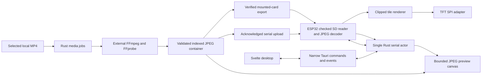

# Muse Video Bridge architecture

Current implementation: Phase 3 with the 2026-11-13 hardware/USB investigation.
The approved research rationale is retained
in [PHASE_1_REPORT.md](PHASE_1_REPORT.md); firmware details and measured build sizes are
in [PHASE_2_REPORT.md](PHASE_2_REPORT.md). Current measured behavior is in
[REAL_HARDWARE_PERFORMANCE_REPORT.md](REAL_HARDWARE_PERFORMANCE_REPORT.md).
No technology replacement was required.

## Boundaries and data flow

| Directory/module | Implemented responsibility |
| --- | --- |
| `src/App.svelte` | One preview-led workflow, native-picker actions, conversion/storage jobs, confirmed controls and compact monitor |
| `src/lib/Preview.svelte` | One in-flight binary JPEG decode, bounded ImageBitmap lifetime, clipped nearest-neighbor canvas rendering |
| `src/lib/sync.ts`, `types.ts` | Typed state, stale/reordered generation/revision guards and rotated aspect math |
| `src/lib/i18n.ts`, `localization/*.json` | Complete Turkish/English application catalog; localized errors, numeric units and copy |
| `src/lib/design/tokens.css`, `Icon.svelte` | Existing Muse roles, local Manrope, shapes, spacing, focus/motion and shared outlined icon family |
| `src-tauri` | Native dialogs and narrow commands; event forwarding; per-user directories and window-close cleanup |
| `crates/muse-video-desktop` | Selected input/artifact ownership, cached preview index, joined/cancellable jobs, versioned settings and serial actor |
| `crates/muse-video-core` | FFmpeg lifecycle, checked container/JPEG parser, safe storage and serial framing/upload |
| `crates/muse-video-cli` | Independent documented CLI using the same core |
| `firmware/include` | Portable C++ container, protocol, scheduler, decoder/renderer and upload state machine |
| `firmware/src/main.cpp` | Classic ESP32 display/SD/UART/task/telemetry adapters with explicit reference GPIOs |

Settings and cache normally use Tauri's per-user application directories. A checked
`portable-mode.json` beside the executable opts into adjacent `Data/config` and
`Data/cache`; Windows WebView2 profile data also uses `Data/cache/webview`. The window
is created after backend state initialization so that this directory can be selected.
Default tool names resolve to bundled `tools/` executables when present; explicit paths
remain unchanged. Packaging is separated under `packaging/`, including a backup-first
PowerShell flasher with catalog-owned tr/en copy. The desktop itself never flashes.
Locale/theme/qscale/FPS,
fit/tool paths and last selected port persist. Video selection is per session. Cache jobs
and partials are retained; there is no automatic cleanup or user-data reset. Unrecognized
settings are backed up before user-requested replacement. Frontend saves are serialized.

## Processing and storage ownership

Native file selection registers the source in Rust; the webview cannot choose arbitrary
preview paths. FFmpeg receives argument arrays, bounded stderr, watchdog/cancellation and
no shell. Conversion/verification/export/upload run outside the UI thread. A bounded
progress channel reports actual frame/byte stages. A failed conversion leaves a recognizable
partial/failure record; retry creates a new job. A validated artifact/index reader is cached
once and checks the requested digest/frame bound for preview.

Card selection registers a canonical directory. Export accepts that selected destination,
qualifies filesystem/capacity, stages, syncs, rereads hash/CRCs, then publishes without
replacing unrelated media. App-generated `active.json` replacement preserves its previous
recognized version. FAT flush/rename is not a power-loss transaction; OS safe eject remains
necessary. Test-directory bypass exists only in explicitly invoked host test code/CLI.

The serial actor owns one selected port and a 16-command queue. It uses 115200 baud,
finite read/response timeouts, checksummed envelopes and retry receipts. RTS and DTR
are explicitly released on open; this repaired the observed CH340 reset-line failure.
It never probes all listed
ports by transmitting bytes. Full status/heartbeat is normally requested at 1 Hz; frame
events are at most 10 Hz. Upload is cancellable directly while the actor owns the transfer.
Closing cancels/joins conversion/export/upload workers and shuts down/joins the actor.
Explicit user cancellation confirms the upload identity before removing only its
incomplete files; transport failures keep recovery checkpoints. Per-digest journals
allow another upload while preserving a different legacy recovery. Full publication
requires verified size/SHA-256 and container/frame integrity. The native Linux app
has completed this workflow with the microSD inside the connected ESP32.

The queue/playback extension makes the firmware authoritative for queue order,
current video, playback mode and preparation. The desktop retains a separate
prepared-artifact registry for conversion/preview ownership. See
[QUEUE_AND_PLAYBACK.md](QUEUE_AND_PLAYBACK.md) for synchronization and state contracts.

## Live synchronization

A transform contains X/Y, final rotated width/height, quarter-turn angle and aspect lock.
Scale changes those dimensions relative to the encoded source; it is not an additional
multiplier. Position/size/rotation are coalesced over 100 ms with one request in flight.
The requested preview updates immediately, while a pending label remains until status
confirms the accepted revision. FPS has separate requested/confirmed state; measured
actual FPS comes only from firmware completed draws. Failed requests restore confirmed
values and expose localized errors.

Frame events must match the current connection session, playhead generation, confirmed
state revision and forward frame/PTS order. Older seek/transform status is ignored.
A new session clears pending commands. Reconnect acquires HELLO and telemetry rather than
replaying old requested settings. Values become stale after 3.5 seconds without valid
reports; a disconnected/stale screen retains only a clearly labeled last known preview.
A stop with no drawn frame clears preview to black. Different content hashes show a local
preview/mismatch notice, never claim device synchronization. Live transform editing needs
a matching local artifact to know the source dimensions.

Preview reads only the selected converted JPEG frame, not the MP4 repeatedly. One decoded
bitmap is retained and closed on replacement/unmount. Frame reports and full telemetry use
separate events so the monitor does not update for every frame. No unbounded history or
whole-video framebuffer is maintained. Browser JPEG color/resampling can differ slightly
from JPEGDEC/RGB565; this is a reconstruction of reported state, not pixel-exact TFT capture.

## Firmware and telemetry

The Arduino loop owns decoder/TFT presentation and advances loading, playback,
hash/index verification and transfer work. A core-0 serial task uses bounded
reply/event queues, giving replies priority. The native-size/zero-rotation path
passes RGB565 blocks to a continuous TFT transaction; transforms use a clipped
fallback. The optional compressed prefetch worker reads one bounded future record,
and is joined before storage/control boundaries. Optional JPEG first-block warmup
overlaps next-frame preparation with the final owned DMA transfer; `end_frame()`
still confirms completion before the current frame counts as presented. The
selected `cyd_optimized_input_aligned` production path uses three exclusive,
16-byte-aligned RGB565 output strips with two queued DMA transfers. The codec
leases a writable strip, submission transfers ownership to SPI, and exact FIFO
completion permits reuse. Copied DMA/polling and transform paths remain checked
fallbacks. The fixed compressed record is also aligned to16 bytes; actual input
offsets are diagnostic evidence rather than an assumed universal speedup.
Fast startup clears only outside the video's clipped region at the existing
media-clock anchor. The rejected SD-first-record preload stays outside production.
Control latency can include a frame/SD call; no zero-latency guarantee is made.
Compressed slots and decoder tiles avoid full RGB framebuffers/PSRAM. Boot with no valid media draws the keyed English
waiting screen and card/connection status; valid media starts after validation.

The absolute rational media clock preserves duration as requested FPS changes. Rate skips,
late/dropped eligible frames and completed-draw actual FPS are distinct. Seeking increments
a generation and independently decodes an indexed JPEG. Telemetry uses ESP APIs for heap,
flash, PSRAM, frequency, SD and Wi-Fi; CPU utilization uses supported idle-runtime deltas.
Temperature is unavailable. Host adapters return null for ESP hardware measurements and
explicitly identify themselves as a simulator. Actual ROM chip/flash identification is
recorded in HARDWARE.md. Runtime CPU/heap/no-PSRAM, SD read/seek, JPEG decode,
TFT clocks/DMA ownership, completed actual FPS and physical TFT-memory integrity
have now been measured on the connected CYD. Measurements and their limits remain
separate from target/source FPS and desktop preview reconstruction.

## Security, design and platform scope

Tauri exposes no general shell/filesystem/serial plugin API to the webview. Capabilities
allow core events/window behavior; native dialogs are backend-owned. CSP blocks remote
content/fonts/scripts. Text is rendered as text, including diagnostics. The injectable
browser verification bridge is development-only and absent from production assets;
production initialization passes no simulator transport.

The interface adopts Muse's existing Material 3 color roles, Manrope and outlined icons.
One main workflow and collapsible secondary controls avoid an editor/dashboard structure.
Light/dark/system themes, native controls, visible keyboard focus, narrow reflow, zoom and
reduced motion are implemented. Existing Muse instructions remain unchanged.

Windows and Linux adapters are kept separate. Linux native MP4 selection/conversion and
host-browser/engine integration are tested; Windows x64 release cross-build and package
integrity are verified. Real Linux desktop USB upload/size/hash/playback and controls
are verified on the physical CYD. Windows runtime/installers/COM workflows remain
unverified. macOS is not a delivery target. Historical Phase 3 boundaries are in
[PHASE_3_REPORT.md](PHASE_3_REPORT.md); current evidence and remaining qualification
are in the [hardware report](REAL_HARDWARE_PERFORMANCE_REPORT.md).
